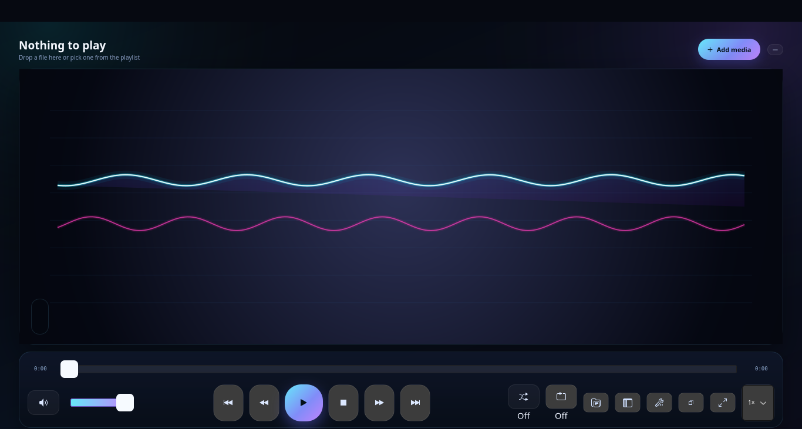
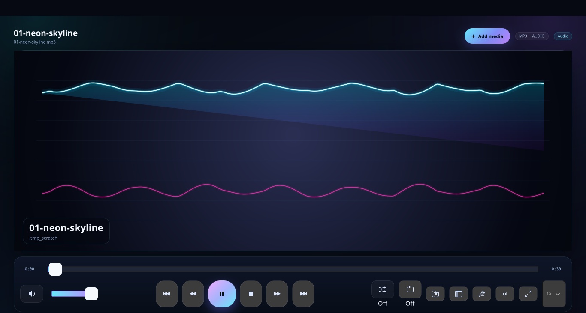
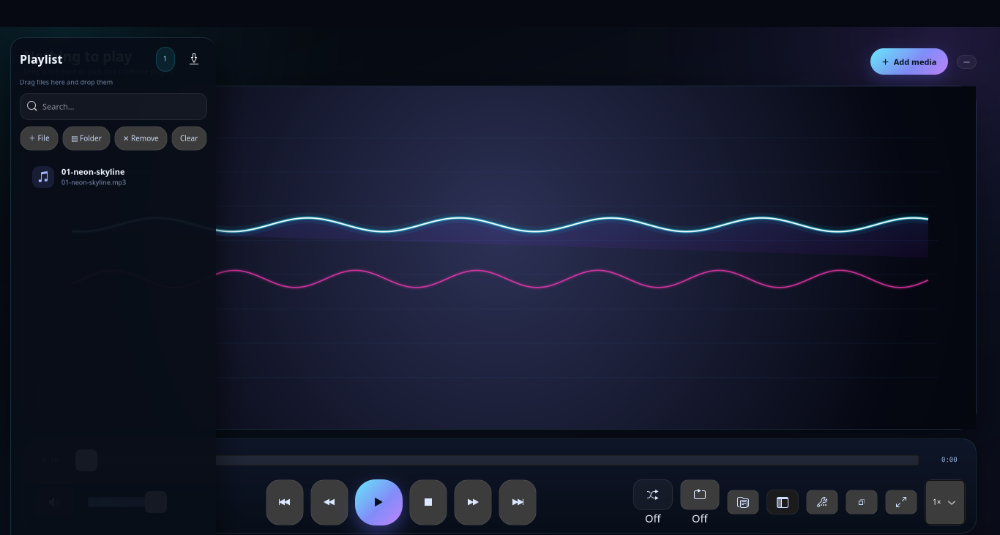
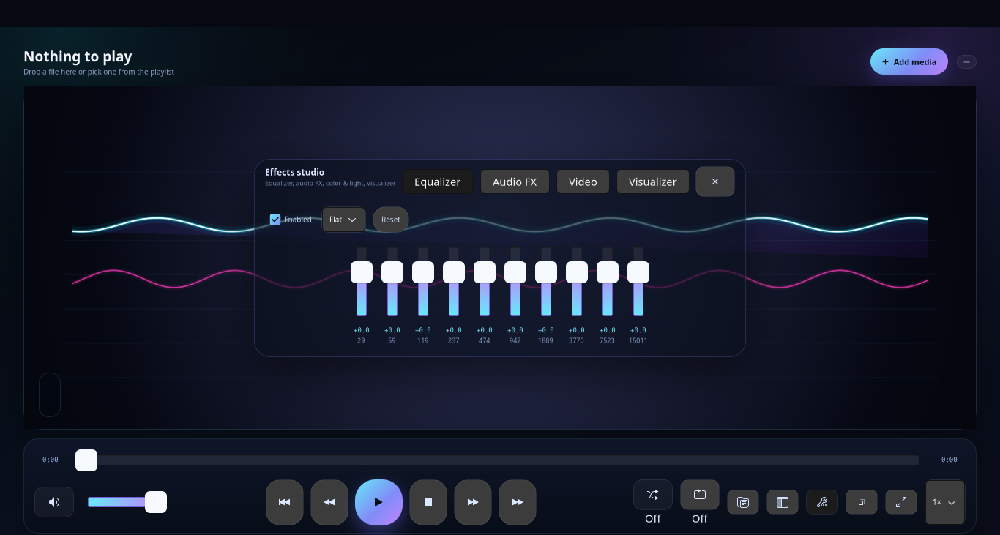
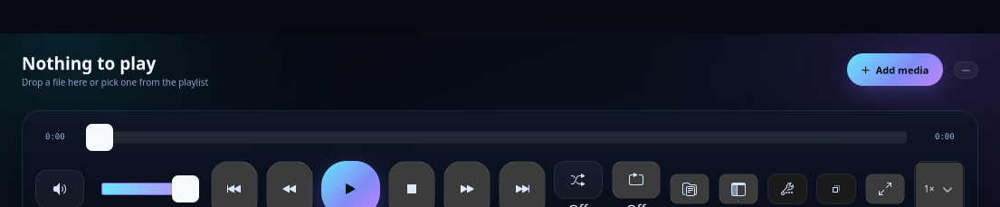

# Nava Studio

[](https://github.com/shirazelec/nava-studio)
[](https://shirazelectronic.ir)
[](LICENSE)
[](https://github.com/shirazelec/nava-studio)

Nava Studio is a lightweight, high-performance media player written in pure C using GTK 4 and FFmpeg. It features a responsive modern interface without bulky titlebars or nested menus, low-latency audio output, hardware-accelerated video playback, a 10-band graphic equalizer, and realtime audio visualizers.

---

## Screenshots

### Main Interface & Playback


### Realtime Audio Visualizer


### Playlist Drawer (Slide-in)


### 10-Band Graphic Equalizer & DSP Effects


### Compact Mini-Player Mode


---

## Features

- **Native C & GTK 4**: Fast startup, low memory footprint, and smooth Wayland/X11/macOS/Windows desktop integration.
- **FFmpeg 8 Core**: Multi-threaded demuxing and decoding supporting virtually every modern audio and video format.
- **Audio Output Backends**:
  - Linux: PulseAudio / PipeWire (`libpulse-simple`)
  - macOS: Native CoreAudio (`AudioQueue`)
  - Windows: WASAPI low-latency shared mode
- **10-Band Graphic Equalizer**: Precise biquad filter bank with customizable frequency response and preamp gain.
- **Audio DSP Suite**: Real-time crossfade, stereo wideness, echo, peak limiter, dynamic range compression, and volume normalization.
- **Video Controls**: Real-time hardware-accelerated adjustments for brightness, contrast, saturation, gamma, and hue.
- **13 Visualizer Modes**: Cairo-rendered hardware-accelerated stage visualizers (Spectrum Bars, Laser Oscilloscope, Cosmic Belt, Analog VU Meters, Constellation Particles, Vortex, Torus, and more).
- **Playlist Management**: Search filtering, track reordering, automatic M3U/M3U8 import, duplicate detection, and drag-and-drop.
- **Mini-Player & Fullscreen**: Compact floating widget mode (`Ctrl+M`) and distraction-free fullscreen mode (`F11`) with auto-hiding transport controls.
- **System Integration**: MPRIS2 D-Bus remote control interface on Linux (hardware media keys, lock screen widgets, GNOME/KDE integration).

---

## Supported Formats & Codecs

Nava Studio relies on libavformat and libavcodec, providing comprehensive coverage across common and professional media formats:

| Category | File Extensions / Containers | Supported Codecs |
|---|---|---|
| **Lossless Audio** | `.flac`, `.wav`, `.alac`, `.aiff`, `.ape`, `.wv` | FLAC, PCM (8/16/24/32-bit int, 32/64-bit float), ALAC, Monkey's Audio, WavPack |
| **Lossy Audio** | `.mp3`, `.m4a`, `.aac`, `.ogg`, `.opus`, `.wma` | MP3 (MPEG-1/2 Audio Layer III), AAC (LC, HE, HEv2), Vorbis, Opus, WMA v1/v2, AC3, E-AC3, DTS |
| **Video Containers** | `.mp4`, `.mkv`, `.webm`, `.avi`, `.mov`, `.flv`, `.ts`, `.m4v` | H.264 (AVC), H.265 (HEVC), AV1, VP8, VP9, MPEG-4 Visual, MPEG-2, ProRes |
| **Playlists** | `.m3u`, `.m3u8`, `.pls` | Relative and absolute path parsing, UTF-8 playlist indexing |
| **Metadata & Tags** | Tag embedded | ID3v1, ID3v2.3/v2.4, Vorbis Comments, MP4/iTunes atoms, FLAC vorbis blocks, embedded JPEG/PNG album art |

---

## Downloads & Releases

Ready-to-use installers and portable packages for all platforms are available on the [Releases](https://github.com/shirazelec/nava-studio/releases) page:

- **Linux (x86_64):** `nava-studio_1.0.0_amd64.deb` and portable `.tar.gz`
- **macOS (Apple Silicon):** `NavaStudio-1.0.0-macos-arm64.dmg` (drag-and-drop to `/Applications`) and portable `.tar.gz`
- **Windows (x64):** `NavaStudio-1.0.0-windows-x64-installer.exe` (setup wizard with desktop & start menu shortcuts) and standalone `.zip`

---

## Installation & Building

Nava Studio can be built using either standard GNU `make` or `cmake` (version 3.16 or newer).

### 1. Linux (Ubuntu / Debian / Fedora / Arch)

#### Prerequisites

**Debian / Ubuntu:**
```bash
sudo apt update
sudo apt install build-essential cmake pkg-config \
     libgtk-4-dev libgraphene-1.0-dev libpulse-dev \
     libavcodec-dev libavformat-dev libavutil-dev \
     libswscale-dev libswresample-dev
```
*(Note: If building against the vendored FFmpeg source included in `third_party/ffmpeg`, the `libav*-dev` system packages are optional.)*

**Fedora / RHEL:**
```bash
sudo dnf install gcc gcc-c++ make cmake pkgconf \
     gtk4-devel graphene-devel pulseaudio-libs-devel \
     ffmpeg-free-devel
```

**Arch Linux:**
```bash
sudo pacman -S base-devel cmake pkgconf gtk4 graphene libpulse ffmpeg
```

#### Build with CMake
```bash
cmake -B build -DCMAKE_BUILD_TYPE=Release
cmake --build build -j$(nproc)
sudo cmake --install build
```

#### Build with Make
```bash
make -j$(nproc)
sudo make install
```

#### Build Debian (.deb) Package
```bash
make deb
# Installs to dist/nava-studio_1.0.0_amd64.deb
sudo dpkg -i dist/nava-studio_1.0.0_*.deb
```

---

### 2. macOS

#### Prerequisites
Install dependencies via [Homebrew](https://brew.sh/):
```bash
brew install cmake pkg-config gtk4 ffmpeg
```

#### Build
```bash
cmake -B build -DCMAKE_BUILD_TYPE=Release
cmake --build build -j$(sysctl -n hw.ncpu)
```
The CoreAudio backend (`NAVA_AUDIO_COREAUDIO`) is automatically selected.

---

### 3. Windows (MSYS2 / MinGW-w64)

#### Prerequisites
1. Download and install [MSYS2](https://www.msys2.org/).
2. Open the **MSYS2 UCRT64** or **MINGW64** shell and install dependencies:
```bash
pacman -Syu
pacman -S --needed \
    mingw-w64-x86_64-toolchain \
    mingw-w64-x86_64-cmake \
    mingw-w64-x86_64-ninja \
    mingw-w64-x86_64-pkgconf \
    mingw-w64-x86_64-gtk4 \
    mingw-w64-x86_64-ffmpeg
```

#### Build
```bash
cmake -B build -G "Ninja" -DCMAKE_BUILD_TYPE=Release
cmake --build build
```
The Windows WASAPI audio engine (`NAVA_AUDIO_WASAPI`) is automatically compiled.

---

## Keyboard Shortcuts

| Shortcut | Action |
|---|---|
| `Space` | Play / Pause playback |
| `Left` / `Right` | Seek backward / forward 5 seconds |
| `Shift + Left` / `Shift + Right` | Seek backward / forward 30 seconds |
| `Up` / `Down` | Volume up / down (5%) |
| `M` | Mute / Unmute audio |
| `Ctrl + O` | Open file dialog |
| `Ctrl + Shift + O` | Open folder / directory |
| `Ctrl + L` | Toggle playlist drawer |
| `Ctrl + M` | Toggle mini-player mode |
| `F11` / `Double Click` | Toggle fullscreen mode |
| `Esc` | Exit fullscreen / close open overlays |
| `Delete` | Remove selected track from playlist |
| `F1` | Open About dialog |

---

## Project Structure

```
.
├── CMakeLists.txt        # Multi-platform CMake build configuration
├── Makefile              # GNU Make build script with OS auto-detection
├── data/                 # Desktop entry (.desktop), MIME types, and icons
├── docs/                 # Documentation assets and screenshots
│   └── screenshots/
├── resources/            # GTK CSS themes and GResource definitions
├── scripts/              # Packaging, runner, and MIME registration helpers
├── src/
│   ├── app.c             # GTK4 user interface, window lifecycle, and controls
│   ├── audio_out.c       # Low-latency backends (PulseAudio, CoreAudio, WASAPI)
│   ├── dsp.c             # 10-band equalizer, crossfade, and dynamics processing
│   ├── engine.c          # FFmpeg demuxing, decoding, and audio/video sync servo
│   ├── vis.c             # Realtime Cairo audio visualizers
│   └── main.c            # Application entry point
└── third_party/          # Vendored FFmpeg source tree
```

---

## Author & License

Designed and developed by **Shiraz Electronic** ([shirazelectronic.ir](https://shirazelectronic.ir)).  
Maintained by **shirazelec** (<https://github.com/shirazelec/nava-studio>).

Released under the **GNU General Public License v3.0** (GPLv3). See [LICENSE](LICENSE) for the complete text.
Third-party libraries (FFmpeg, GTK4, Cairo) are licensed under their respective LGPL/GPL/MIT licenses.
